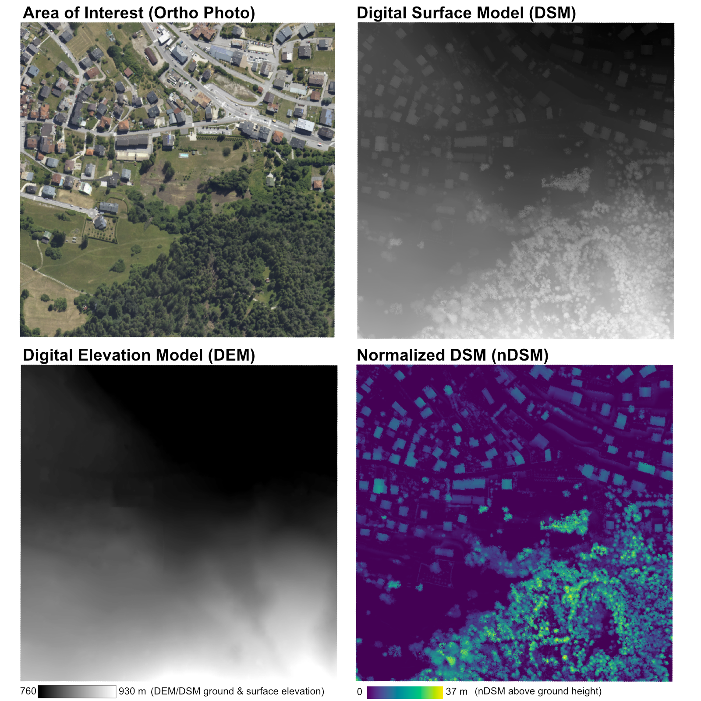

# LiDAR DEM / DSM Processing Workflow

A Python-based workflow for processing large drone LiDAR point clouds into DEM, DSM, and nDSM raster products using open-source tools.

<p align="center">
  
</p>

*Example outputs for the sample dataset: area of interest (ortho photo, top left), DSM (top right), DEM (bottom left, 760–930 m), and nDSM (bottom right, 0–37 m above ground). Sample data: [LiDAR and Photogrammetry Point Clouds and R code for University of Padova courses on Geomatics for Forest and Environmental Sciences](https://doi.org/10.5281/zenodo.17934978).*

## Why I built this

I originally developed a prototype of this code while working in consulting, where drone LiDAR processing using proprietary software was often time-consuming, highly manual, and more expensive than it needed to be. The goal was to explore whether a more automated, reproducible workflow could reduce both total processing time and the amount of user interaction required, helping teams move data through analysis faster while also avoiding unnecessary project budget overhead.

This repository has been expanded from the orignal prototype to test large drone LiDAR datasets and evaluate a more efficient processing approach. It is intended as foundational LiDAR processing code which can be built upon for further development.

## What it does

This notebook processes raw airborne or drone LiDAR point clouds (`.las` / `.laz`) into:

- **DEM** (Digital Elevation Model)
- **DSM** (Digital Surface Model)
- **nDSM** (normalized DSM / above-ground height surface)

The figure above shows the DEM, DSM, and nDSM generated from the sample dataset.

The workflow includes:

- LiDAR metadata inspection and CRS extraction
- Tiling and buffered tiling for large datasets
- Local outlier filtering
- Ground / non-ground classification using Cloth Simulation Filtering (CSF)
- Per-tile DEM and DSM generation using TIN-based interpolation
- Mosaicking of tile rasters into final outputs
- DEM void identification, fill mask creation, and first-pass void filling
- DEM / DSM grid alignment before nDSM generation
- Basic tile-level QA summaries

A few processes have been intentionally kept simple in this version, notably:

- DEM void filling
- QA / validation outputs
- user configuration and packaging
- more advanced urban / vegetation handling

## Installation and setup

This project is organized as a Jupyter Notebook workflow and is intended to run in a dedicated Python environment.

1. Clone the repository and move into the project folder:
   ```bash
   git clone https://github.com/<your-username>/<your-repo>.git
   cd <your-repo>
   ```

2. (Recommended) Create and activate a virtual environment:
   ```bash
   python -m venv .venv
   source .venv/bin/activate  # On Windows PowerShell: .venv\Scripts\Activate.ps1
   ```
   
3. Install the required Python packages from `requirements.txt`:
   ```bash
   pip install -r requirements.txt
   ```

4. Place your input `.las` or `.laz` file under `data/raw/` (the sample dataset linked above works for a first test) and update the `LIDAR_FILENAME` and path settings in the configuration cell of `lidar_dem_dsm_workflow.ipynb`.

5. **Check and set `FALLBACK_CRS`** in the configuration cell. If your `.las`/`.laz` file has no coordinate reference system (CRS) in its header, the workflow uses this value instead, so it must match your data (for example, `"EPSG:32618"`). The default, `EPSG:7791`, is specific to the sample dataset and may not work for other data. An incorrect CRS will produce misplaced rasters without raising an error.

6. Open `lidar_dem_dsm_workflow.ipynb` in JupyterLab, VS Code, or another notebook interface and run the cells from top to bottom.

## Inputs and outputs

**Input**
- Raw LiDAR point cloud in `.las` or `.laz` format

**Main outputs**
- `dem_raw.tif`
- `dem_filled.tif`
- `dem_fill_mask.tif`
- `dsm_final.tif`
- `ndsm_final.tif`

Additional intermediate products and tile-level summaries are also created during processing.

## What I learned

- Large drone LiDAR workflows benefit substantially from **tiling, buffering, and automated intermediate handling**.
- Open-source Python tools can reproduce much of the core DEM / DSM workflow typically done in proprietary desktop software.
- Automating preprocessing and raster generation reduces repeated manual effort and makes the workflow easier to review, test, and improve.
- Even in a prototype, explicit handling of CRS, grid alignment, and void filling matters if the outputs are going to be trusted downstream.
- Tile-level summaries are useful for catching classification issues early, especially when testing different CSF settings or preprocessing thresholds.

## Stack

- Python
- Jupyter Notebook
- laspy
- whitebox_workflows
- CSF-3DFin
- rioxarray
- rasterio
- xarray
- numpy
- scipy
- geopandas
- shapely

## Notes

This repository is intended as an open, inspectable prototype for LiDAR processing experimentation and workflow development. It is best suited for users who are comfortable working in Python and who want a transparent alternative to more manual LiDAR processing workflows.

## License

This prototype is licensed under the MIT License so that others can freely use, adapt, and integrate it into their own workflows. As a courtesy, please avoid reselling the repository as-is without meaningful changes, and always retain clear attribution to the original author in derivative work. Contributions and improvements are welcome.